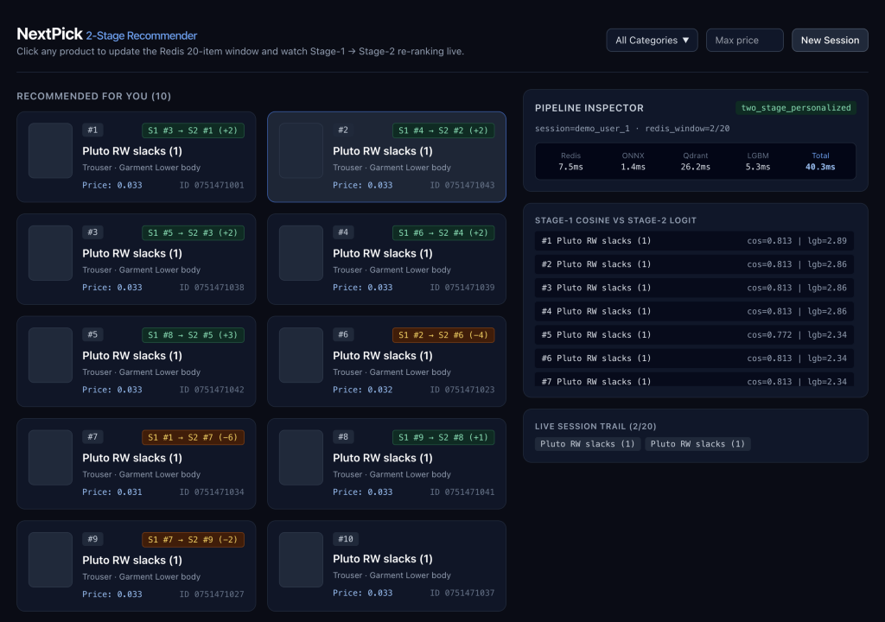

# NextPick — 2-Stage Real-Time Product Recommendation System

Real-time e-commerce retrieval and ranking engine built on **PyTorch Two-Tower**, **ONNX Runtime**, **Qdrant (HNSW)**, **Redis**, **LightGBM (`lambdarank`)**, **FastAPI**, and a **Next.js Pipeline Inspector**.



---

## Architecture

```text
Next.js Storefront + Pipeline Inspector
        │
        ├── POST /event ──► Redis Bounded Window (LPUSH + LTRIM 0 19 + TTL)
        │
        └── GET /recommend
                ├── 0 clicks ──► Cold-Start Trending Cache
                └── >=1 click ─► ONNX User Tower (recency-decay pooling)
                                      │
                                      ▼
                                 Qdrant HNSW (Top-100 + with_payload=True)
                                      │
                                      ▼
                                 LightGBM lambdarank (9 zero-skew features)
                                      │
                                      ▼
                                 Top-10 Ranked + Rank Deltas + Latency ms
```

---

## Key Engineering Decisions

- **Cold-Start-Safe Two-Tower:** Avoids pure ID embeddings; Item Tower combines frozen `all-MiniLM-L6-v2` text embeddings + categorical/price embeddings, while User Tower applies exponential recency-decay pooling ($w_k = \exp(-\lambda k)$) over the last 20 interactions.
- **Anti-Bias Training:** In-batch softmax with temperature ($\tau = 0.07$), **same-item collision masking** off-diagonal, and **`logQ` popularity correction**.
- **Zero Train-Serving Skew:** Offline history computed in **DuckDB** (`ROWS BETWEEN 20 PRECEDING AND 1 PRECEDING`) matches the live **Redis** `LPUSH + LTRIM 0 19` window identically via shared feature logic in `src/models/stage2_features.py`.
- **Single-Hop Stage-2 Metadata:** Item metadata (`price`, `department_name`, `product_group_name`, `train_tx_count`, `image_url`) is stored inside Qdrant payloads (`with_payload=True`) — zero extra DB lookups per `/recommend`.

---

## Ablation & Benchmark Results (H&M 8-Week Temporal Split)

Evaluated on a **date-level temporal split** (`ORDER BY t_dat, row_id`, predicting 7-day Week 8 future-horizon purchases from each user's first Week-8 interaction using strictly Weeks 1–7 history) across **35,576 active SKUs** (`1,678,323` train / `255,241` val / `240,311` test transactions):

| Model / Pipeline Stage | Recall@50 | NDCG@10 | MRR@10 |
| :--- | :---: | :---: | :---: |
| Popularity Baseline (Weeks 1–6) | 0.0493 | 0.0088 | 0.0131 |
| Two-Tower (No `logQ` — collapses popular items) | 0.0036 | 0.0006 | 0.0008 |
| Two-Tower (`In-Batch + logQ + Decay`) | 0.0711 | 0.0236 | 0.0291 |
| **Two-Tower + LightGBM Stage 2** | **0.0773** | **0.0267** | **0.0340** |

### Serving Load Test (`locust` — 20 Concurrent Users, 60s, Single-Worker Uvicorn + Docker Qdrant/Redis)
- **Throughput:** `86.96 req/s` (`5,165` requests, **0.00% failures**)
- **`POST /event`:** `21 ms` median · `92 ms` p95
- **`GET /recommend` (2-stage personalized):** `~95 ms` median · `~260 ms` p95
- **Aggregated (`/event` + `/recommend`):** `75 ms` median · `240 ms` p95 · `480 ms` p99

### Evaluation & Reproducibility Audit
- **Raw Metrics Output:** [`docs/ablation_metrics.json`](docs/ablation_metrics.json) (exported directly from Kaggle Week 8 evaluation)
- **Temporal Split & Causal History:** [`src/data/temporal_split.py`](src/data/temporal_split.py) (`ROWS BETWEEN 20 PRECEDING AND 1 PRECEDING`)
- **Metric Definitions:** [`src/eval/metrics.py`](src/eval/metrics.py) (per-user `Recall@50`, `NDCG@10`, `MRR@10`)
- **Training & Stage-2 Script:** [`notebooks/kaggle_train_pipeline.py`](notebooks/kaggle_train_pipeline.py)
- **Load Test Script:** [`bench/locustfile.py`](bench/locustfile.py) (`make bench`)

---

## Quickstart

### 0. Instant 60-Second Demo (No Kaggle Required)
```bash
make demo   # Generates 500 demo SKUs + user_tower.onnx, boots Qdrant & Redis, indexes Qdrant
make api    # Starts FastAPI on :8000
make web    # Starts Next.js Storefront + Pipeline Inspector on :3000
```

### 1. Full H&M Training & Export (Kaggle T4 GPU)
Upload `notebooks/kaggle_train_pipeline.py` to a Kaggle notebook with the H&M Personalized Fashion dataset attached, run it, and place the exported files (`user_tower.onnx`, `item_embeddings.parquet`, `lgbm_ranker.txt`, `catalog.parquet`) into `./artifacts/`.

### 2. Start Qdrant, Redis & FastAPI Locally
```bash
docker compose up -d
PYTHONPATH=. python src/index/qdrant_loader.py
PYTHONPATH=. uvicorn src.serving.main:app --host 0.0.0.0 --port 8000
```

### 3. Run the Next.js Storefront + Pipeline Inspector
```bash
cd web
npm install
npm run dev
```

### 4. Run Tests & Load Benchmark
```bash
PYTHONPATH=. pytest -v
locust -f bench/locustfile.py --host http://localhost:8000
```
