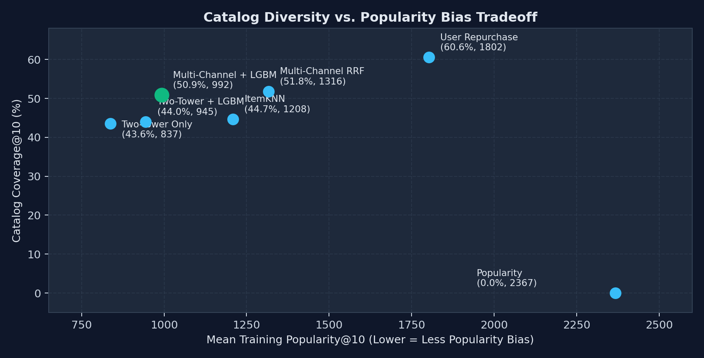
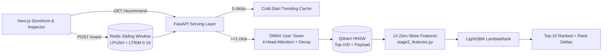

# NextPick — 2-Stage Real-Time Product Recommendation System

[](https://github.com/AmoghRG/NextPick/actions/workflows/ci.yml)


Real-time e-commerce retrieval and ranking engine combining a **cold-start-safe PyTorch Two-Tower** (4-head masked self-attention + recency decay), **Qdrant (HNSW)**, **Redis** sliding-window session state, **LightGBM (`lambdarank`)**, **FastAPI**, and a **Next.js Pipeline Inspector**.

[Live Demo](https://nextpickme.vercel.app) · [Architecture](docs/architecture.md) · [Evaluation](docs/evaluation.md) · [Dataset & Leakage](docs/data.md) · [Deployment](docs/deployment.md) · [Limitations](docs/limitations.md)

---

## Live Demo & How to Use

Open **[https://nextpickme.vercel.app](https://nextpickme.vercel.app)** (`Vercel` + `Render` + `Qdrant Cloud` + `Upstash Redis`):

1. **Cold-Start Top 10:** Every fresh visit starts with a `0/20` session (`cold_start_trending`) showing trending Women's, Divided, and Men's H&M SKUs with real product thumbnails and estimated `₹` pricing.
2. **Click to Personalize:** Click any product card to log a `POST /event` click into Upstash Redis (`LPUSH + LTRIM 0 19`). The storefront immediately switches to `two_stage_personalized`, encoding your click trail with `user_tower.onnx`, retrieving Top-100 candidates from Qdrant, and reranking with LightGBM.
3. **Inspect & Filter:** Watch `S1 → S2` rank deltas, per-stage latencies (`Redis / ONNX / Qdrant / LGBM`), and Stage-1 cosine vs. Stage-2 logit scores in the **Pipeline Inspector**. Use **All Categories**, **Max price (₹)**, or **New Session** to explore or reset.

---

## Demo Preview


> **Demo vs. Evaluated Model:** `make demo` generates 500 synthetic SKUs and untrained `user_tower.onnx` weights in ~2 seconds so anyone can boot and inspect the full stack locally; the UI explicitly displays `SYNTHETIC DEMO — RANDOM EMBEDDINGS / UNTRAINED MODEL` when demo artifacts are active. All offline metrics below come from the full H&M Kaggle evaluation (`68,984` users, `35,576` active SKUs).

---

## Problem & Solution

Single-stage recommenders struggle on fashion catalogs with tens of thousands of SKUs: global popularity collapses to a handful of bestsellers (`0.03%` catalog coverage), while scanning every item with a heavy ranker is too slow for real-time serving.

NextPick solves this with a **2-stage retrieval + ranking pipeline** and **shared zero-skew feature engineering** (`src/models/stage2_features.py`):
- **Stage 1** retrieves semantic & cold-start candidates in milliseconds via **ONNX User Tower + Qdrant HNSW**, complemented in offline evaluation by **User Repurchase** and **ItemKNN** co-visitation channels.
- **Stage 2** reranks candidates using **LightGBM LambdaRank** over `14` point-in-time features computed identically in DuckDB (offline) and Redis (online).

---

## Key Results (H&M Week-8 Temporal Holdout, `N = 68,984` Users)

| Model / Pipeline Stage | Recall@50 | NDCG@10 | Coverage@10 | Mean Pop@10 |
| :--- | :---: | :---: | :---: | :---: |
| Popularity Baseline (Weeks 1–6) | 0.0493 | 0.0088 | 0.03% | 2,366.8 |
| ItemKNN Co-Visitation Baseline | 0.0611 | 0.0169 | 44.70% | 1,208.4 |
| Two-Tower Only (`In-Batch + logQ + Attention + Decay`) | 0.0768 | 0.0265 | 43.56% | 837.2 |
| Multi-Channel Unranked (RRF: ANN-80 + Rep-20 + KNN-20) | 0.0934 | 0.0317 | 51.81% | 1,316.0 |
| User Repurchase Baseline | 0.0793 | 0.0337 | 60.56% | 1,802.1 |
| **Multi-Channel Stage 1 + LightGBM Stage 2 (14 features)** | **0.0976** | **0.0349** | **50.85%** | **992.4** |

- **Statistically positive paired lift:** Paired bootstrap 95% CIs on per-user $\Delta\text{NDCG@10}$ (`1,000` resamples) are strictly above zero against every baseline, including **Popularity** (`+0.0261 [+0.0251, +0.0271]`), **ItemKNN** (`+0.0180 [+0.0171, +0.0190]`), **Two-Tower Only** (`+0.0084 [+0.0077, +0.0090]`), **Multi-Channel RRF** (`+0.0032 [+0.0026, +0.0038]`), and **User Repurchase** (`+0.0012 [+0.0005, +0.0018]`).
- **Candidate Pool Diagnostics:** `12.46%` Candidate Recall (`24.51%` user hit rate, `99.84` avg unique items/user), with unique ground-truth hits contributed by **Two-Tower ANN (`43.51%`)**, **Repurchase (`17.76%`)**, and **ItemKNN (`4.51%`)**.

| Model Comparison | Paired $\Delta\text{NDCG@10}$ (95% CI) |
| :---: | :---: |
|  |  |



---

## Architecture



See [docs/architecture.md](docs/architecture.md) for the Two-Tower encoder design, `logQ` loss, collision masking, and Qdrant fail-fast validation.

---

## How It Works

1. **Session Ingestion (`POST /event`):** Pushes user clicks into a bounded Redis list (`LPUSH + LTRIM 0 19 + TTL`).
2. **Retrieval (`GET /recommend`):** 0-click sessions route to a cold-start trending cache; active sessions encode the 20-item history via `user_tower.onnx` and retrieve Top-100 candidates + metadata from Qdrant (`with_payload=True`).
3. **Feature Engineering & Reranking:** Computes `14` zero-skew cross-features in [`src/models/stage2_features.py`](src/models/stage2_features.py) and scores candidates with LightGBM `lambdarank`.
4. **Transparent Serving:** Returns Top-10 items with `stage1_rank`, `stage2_rank`, `rank_delta`, per-stage `latency_ms`, and explicit `ranker_mode` / `is_synthetic_demo` flags.

---

## Quickstart (60-Second Local Demo)

```bash
python3 -m venv .venv && source .venv/bin/activate
pip install -r requirements.txt

make demo   # Generates 500 demo SKUs + user_tower.onnx, boots Qdrant & Redis, indexes Qdrant
make api    # Starts FastAPI on http://localhost:8000
make web    # Starts Next.js Storefront + Pipeline Inspector on http://localhost:3000
```

For Docker clean-clone builds, Kaggle training, and troubleshooting, see [docs/deployment.md](docs/deployment.md).

---

## Tech Stack

- **ML & Ranking:** PyTorch (`Two-Tower`, `all-MiniLM-L6-v2`), LightGBM (`lambdarank`), DuckDB
- **Serving & Inference:** FastAPI, Uvicorn, ONNX Runtime, Locust
- **Retrieval & State:** Qdrant (HNSW), Redis (bounded sliding window)
- **Frontend & DevOps:** Next.js, TypeScript, Tailwind CSS, Multi-stage Docker, GitHub Actions CI (`test`, `web-build`, `docker-build`)

---

## Serving Load Test & Evaluation

- **Locust Load Test** (local Mac, single-worker Uvicorn + Docker Qdrant/Redis, `20` concurrent users, `60s`): **`86.96 req/s`** (`5,165` requests, **`0.00%` failures**), `75 ms` median / `240 ms` p95 aggregated (`/event` `21 ms` median, `/recommend` `~95 ms` median).
- **Full Evaluation Report:** See [docs/evaluation.md](docs/evaluation.md) and raw JSONs ([`docs/eval_diagnostics.json`](docs/eval_diagnostics.json), [`docs/ablation_metrics.json`](docs/ablation_metrics.json)).

---

## Limitations

NextPick is a portfolio engineering project, not a production retail deployment. Key boundaries—single Week-8 test split, Week-7 single-row vs. Week-8 multi-positive query framing, `24.51%` Stage-1 candidate hit rate, offline-only multi-channel `item_knn_score`, synthetic demo weights, and missing auth/rate-limiting—are documented in [docs/limitations.md](docs/limitations.md).

---

## Documentation & Acknowledgements

- [Architecture Deep-Dive](docs/architecture.md) · [Evaluation & Statistics](docs/evaluation.md) · [Dataset & Leakage Controls](docs/data.md) · [Deployment & API Guide](docs/deployment.md) · [Known Limitations](docs/limitations.md)
- Dataset: [H&M Personalized Fashion Recommendations](https://www.kaggle.com/competitions/h-and-m-personalized-fashion-recommendations) (Kaggle).
