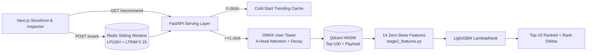

# NextPick System Architecture

NextPick separates **low-latency candidate retrieval** from **context-rich learning-to-rank** so serving scales to tens of thousands of SKUs without scanning the full catalog during `/recommend`.

## End-to-End Architecture

> **Offline vs. Live Candidate Channels:** In offline evaluation ([`notebooks/kaggle_eval_diagnostics.py`](../notebooks/kaggle_eval_diagnostics.py)), Stage 1 merges **Two-Tower ANN (Top-80)** + **User Repurchase (Top-20)** + **ItemKNN Co-Visitation (Top-20)** before LightGBM reranking. In live FastAPI serving ([`src/serving/main.py`](../src/serving/main.py)), Stage 1 queries Qdrant HNSW (`Top-100`) and passes `item_knn_score=0.0` (backward-compatible via `Stage2Ranker`).

---

## Stage 1: Cold-Start-Safe Two-Tower Retrieval

Defined in [`src/models/two_tower.py`](../src/models/two_tower.py):

- **Item Tower (`ItemTower`):** Avoids pure item-ID embeddings so new/cold-start SKUs with metadata and text can be embedded immediately:
  - Frozen `all-MiniLM-L6-v2` text embeddings (`384-d`)
  - Categorical & price embeddings: `product_group_name` (`16-d`), `department_name` (`32-d`), `colour_group_name` (`16-d`), `price_bucket` (`16-d`)
  - MLP (`464 → 256 → 128`) with `LayerNorm`, `GELU`, `Dropout(0.1)`, and `L2` normalization
- **User Tower (`UserTower`):**
  - Takes the user's last `20` item embeddings (`128-d`, ordered most-recent first) + `sales_channel_id` (`8-d`)
  - Applies **4-head masked self-attention** (`q_proj`, `k_proj`, `v_proj`, `attn_out`, residual `LayerNorm`) using basic tensor ops for clean ONNX opset 17 export
  - Applies **exponential recency-decay pooling** ($w_k = \exp(-0.15 k)$) over valid history positions
  - MLP (`136 → 256 → 128`) with `L2` normalization
- **Training Objective (`in_batch_logq_loss`):**
  - Temperature-scaled in-batch softmax ($\tau = 0.07$)
  - Off-diagonal **same-item collision masking** (`-1e9` when `item_ids[i] == item_ids[j]`)
  - **`logQ` popularity correction** subtracting $\log Q(j)$ off-diagonal to prevent popular-item collapse

---

## Stage 2: LightGBM LambdaRank & Zero-Skew Features

Defined in [`src/models/stage2_features.py`](../src/models/stage2_features.py) and [`src/serving/ranker.py`](../src/serving/ranker.py):

Both offline Kaggle training and live FastAPI serving call the exact same `compute_stage2_features_for_candidates(...)` function over `14` features:

| # | Feature | Description | Source |
| :--- | :--- | :--- | :--- |
| 1 | `stage1_cosine_score` | User–item dot product / cosine similarity | Qdrant / Stage 1 |
| 2 | `item_price` | Candidate catalog `avg_price` | Qdrant payload / `catalog.parquet` |
| 3 | `user_avg_price` | Mean price across user's last 20 items | Redis / DuckDB history |
| 4 | `price_abs_diff` | `\|item_price - user_avg_price\|` | Derived |
| 5 | `dept_affinity_count` | Count of user clicks in candidate's `department_name` | Redis / DuckDB history |
| 6 | `group_affinity_count` | Count of user clicks in candidate's `product_group_name` | Redis / DuckDB history |
| 7 | `steps_since_same_dept` | Steps since latest click in `department_name` (`99` if unseen) | Redis / DuckDB history |
| 8 | `item_log_popularity` | `log1p(train_tx_count)` | Qdrant payload / `catalog.parquet` |
| 9 | `sales_channel_id` | Active channel (`1` or `2`) | Request / `transactions_train` |
| 10 | `price_zscore` | `(item_price - user_avg_price) / (user_std_price + 1e-6)` | Derived |
| 11 | `steps_since_same_group` | Steps since latest click in `product_group_name` (`99` if unseen) | Redis / DuckDB history |
| 12 | `is_repurchase` | `1.0` if candidate `article_id` is in user's 20-item history | Redis / DuckDB history |
| 13 | `hist_repurchase_count` | Occurrences of candidate `article_id` in user's 20-item history | Redis / DuckDB history |
| 14 | `item_knn_score` | Recency-weighted ItemKNN cosine co-visitation score | Offline co-visitation / `0.0` default |

---

## Serving & Integrity Guarantees

- **Single-hop Qdrant retrieval:** [`src/index/qdrant_loader.py`](../src/index/qdrant_loader.py) stores item metadata inside Qdrant payloads (`with_payload=True`), avoiding a second database round-trip per `/recommend`.
- **Fail-fast pre-write validation:** `validate_catalog_and_embeddings` rejects null/blank `article_id`s, duplicates, missing catalog-to-embedding coverage, non-finite/negative `avg_price`, and non-finite or mismatched vector dimensions *before* any Qdrant upsert or stale-point pruning.
- **Explicit degradation modes:** `Stage2Ranker.mode` reports `trained_lightgbm` vs. `heuristic_fallback`, `/health` reports dependency states (`redis`, `qdrant`, `onnx`, `lightgbm`, `is_synthetic_demo`), and the Next.js Inspector displays explicit banners for `heuristic_fallback`, `offline_preview`, and `SYNTHETIC DEMO`.
