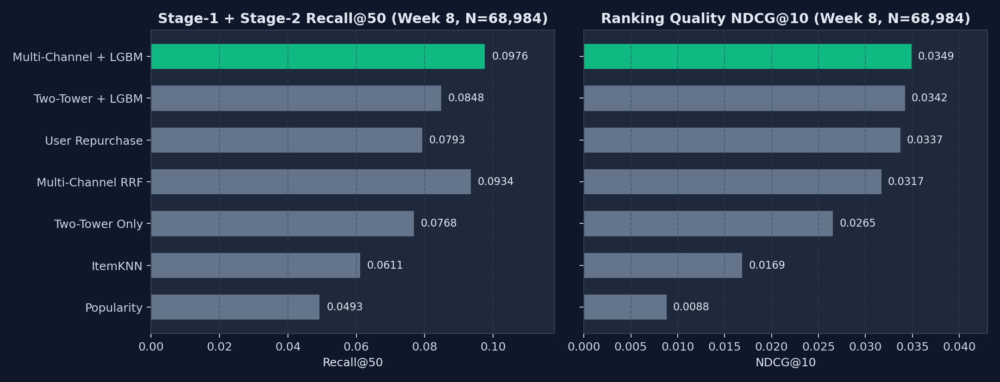
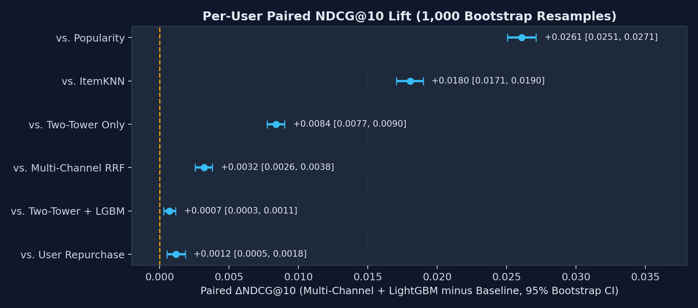
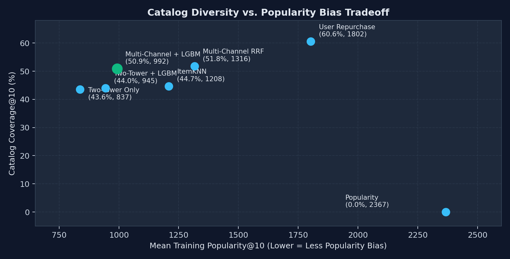

# Evaluation Methodology & Results

All reported evaluation numbers come from [`docs/eval_diagnostics.json`](eval_diagnostics.json), produced by [`notebooks/kaggle_eval_diagnostics.py`](../notebooks/kaggle_eval_diagnostics.py) on **68,984 Week-8 test users** using the trained v6 artifacts (`user_tower.onnx`, `item_embeddings.parquet`, `lgbm_ranker.txt`, `catalog.parquet`).

> **Note on JSON artifacts:** [`docs/eval_diagnostics.json`](eval_diagnostics.json) is the authoritative aligned Week-8 evaluation across all `68,984` users. [`docs/ablation_metrics.json`](ablation_metrics.json) is the legacy `nextpick-train` export retained for `stage2_feature_importance_gain` (its inline `retrieve_topk_for_df` dropped cold-start Week-8 users via `InteractionDataset` filtering).

---

## 1. Temporal Split Protocol

```text
|<-------------- Weeks 1-6 (Train) -------------->|<-- Wk 7 (Val) -->|<-- Wk 8 (Test) -->|
|  1,678,323 transactions                         |  255,241 tx      |  240,311 tx       |
|  Two-Tower + Popularity + ItemKNN fit           |  LightGBM fit    |  Unmodified Eval  |
```

- **Why temporal instead of random:** Random splits leak future fashion trends and user sessions into training.
- **Zero target leakage:** Rolling history uses DuckDB `ROWS BETWEEN 20 PRECEDING AND 1 PRECEDING` ordered by `(t_dat, row_id)`.
- **Test evaluation setup:** At each user's **first** Week-8 interaction (using strictly Weeks 1–7 history), models predict Top-K items evaluated against **all** of that user's Week-8 purchases (7-day future horizon).

---

## 2. Full Controlled Ablation (`N = 68,984` Users)



| Model / Pipeline Stage | Recall@50 | NDCG@10 (95% CI) | MRR@10 | Coverage@10 | Mean Pop@10 |
| :--- | :---: | :---: | :---: | :---: | :---: |
| Popularity Baseline (Weeks 1–6) | 0.0493 | 0.0088 `[0.0084, 0.0092]` | 0.0131 | 0.03% | 2,366.8 |
| User Repurchase Baseline | 0.0793 | 0.0337 `[0.0326, 0.0347]` | 0.0426 | 60.56% | 1,802.1 |
| ItemKNN Co-Visitation Baseline | 0.0611 | 0.0169 `[0.0162, 0.0175]` | 0.0222 | 44.70% | 1,208.4 |
| Two-Tower Only (`In-Batch + logQ + Attention + Decay`) | 0.0768 | 0.0265 `[0.0257, 0.0274]` | 0.0328 | 43.56% | 837.2 |
| Two-Tower + LightGBM (ANN-80 reranked) | 0.0848 | 0.0342 `[0.0332, 0.0352]` | 0.0438 | 44.03% | 944.6 |
| Multi-Channel Unranked (RRF: ANN-80 + Rep-20 + KNN-20) | 0.0934 | 0.0317 `[0.0308, 0.0326]` | 0.0382 | 51.81% | 1,316.0 |
| **Multi-Channel Stage 1 + LightGBM Stage 2 (14 features)** | **0.0976** `[0.0957, 0.0994]` | **0.0349** `[0.0339, 0.0359]` | **0.0435** | **50.85%** | **992.4** |

*(In the separate `No logQ` ablation in `docs/ablation_metrics.json`, removing `logQ` collapsed `Recall@50` to `0.0035` and `NDCG@10` to `0.0006`.)*

---

## 3. Candidate-Pool Diagnostics

Measured over the merged Stage-1 pool (`ANN-80 ∪ Repurchase-20 ∪ ItemKNN-20`) prior to LightGBM reranking:

- **Average unique pool size:** `99.84` items/user
- **Candidate Recall@pool:** `12.46%` (`0.1246`)
- **Candidate Hit Rate:** `24.51%` of Week-8 users receive at least one relevant item in the Stage-1 pool
- **Exclusive channel hit shares** (ground-truth hits found *only* by that channel):
  - **Two-Tower ANN:** `43.51%`
  - **User Repurchase:** `17.76%`
  - **ItemKNN Co-Visitation:** `4.51%`

---

## 4. Statistical Analysis (Paired Per-User Bootstrap)



We compute per-user paired differences $\Delta_u = \text{NDCG@10}_{\text{final}, u} - \text{NDCG@10}_{\text{baseline}, u}$ across all `68,984` users and take percentile 95% confidence intervals from `1,000` bootstrap resamples (`seed=42`):

| Baseline | Mean $\Delta\text{NDCG@10}$ | 95% Paired Bootstrap CI | Wins / Ties / Losses | Non-Zero Win Rate |
| :--- | :---: | :---: | :---: | :---: |
| Popularity | `+0.0261` | `[+0.0251, +0.0271]` | `5,695 / 61,263 / 2,026` | `73.8%` |
| ItemKNN | `+0.0180` | `[+0.0171, +0.0190]` | `4,706 / 61,830 / 2,448` | `65.8%` |
| Two-Tower Only | `+0.0084` | `[+0.0077, +0.0090]` | `4,171 / 62,593 / 2,220` | `65.3%` |
| Multi-Channel RRF | `+0.0032` | `[+0.0026, +0.0038]` | `3,787 / 62,339 / 2,858` | `57.0%` |
| Two-Tower + LGBM | `+0.0007` | `[+0.0003, +0.0011]` | `2,043 / 64,242 / 2,699` | `43.1%` |
| User Repurchase | `+0.0012` | `[+0.0005, +0.0018]` | `3,379 / 61,928 / 3,677` | `47.9%` |

- **Interpretation:** On this single Week-8 split (without multiple-comparison adjustment), every paired 95% CI is strictly above zero. The gain over **User Repurchase** is statistically positive (`+0.00118` NDCG@10) but modest in absolute size, while `Recall@50` improves substantially (`0.0793 → 0.0976`, `+23.1%`).

---

## 5. Coverage, Popularity Bias & Feature Importance



- **Popularity vs. Diversity:** Global Popularity achieves just `0.03%` catalog coverage (`Mean Pop@10 = 2,366.8`). Multi-Channel + LightGBM expands catalog coverage to **`50.85%`** while keeping `Mean Pop@10` at `992.4` (below Multi-Channel RRF's `1,316.0` and Repurchase's `1,802.1`).
- **Top LightGBM Gain Importances** (`docs/ablation_metrics.json`):
  1. `is_repurchase`: `189,394`
  2. `item_knn_score`: `144,446`
  3. `steps_since_same_dept`: `105,124`
  4. `stage1_cosine_score`: `85,755`
  5. `user_avg_price`: `37,200`
  6. `item_log_popularity`: `35,391`
  7. `item_price`: `30,604`
  8. `price_abs_diff`: `21,831`
  9. `price_zscore`: `21,172`
